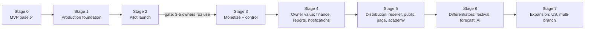

# Master roadmap

> Ye doc **build order ka ek hi source of truth** hai.
> - Kya bana hai, uska live status: [progress.md](progress.md)
> - Kyun bana rahe hain: [product/vision.md](product/vision.md)
> - Kaise banega (har module ka technical plan): [plan/](plan/)
>
> **Last updated:** 2026-11-27

## Kaise padhein
- Kaam **7 stages** mein hai, aur har stage ka ek **exit gate** hai. Gate paar kiye bina agla stage shuru mat karo, warna adhoore features jama ho jaate hain.
- Har kaam ek **module** hai, jiska ID `M-…` hai, aur har module ki **dependencies** tay hain. Module tabhi shuru ho jab uski saari dependencies ✅ hon.
- Bade plans (observability, notifications, business-growth) ke **andar ke phases** alag-alag stages mein bante hain. Neeche ki table mein har phase ka stage likha hai.
- Baaki faisle, approvals aur lawyer/CA ke review neeche **Decision register** mein hain. Koi stage tabhi shuru ho jab uske 🔴/🟡 items ✅ hon.

---

## Stages ek nazar mein



| Stage | Goal | Exit gate (agla stage tabhi) |
|---|---|---|
| **0. MVP base** ✅ | Owner ka roz ka kaam (headcount, delivery, payments, skip, wastage) offline ke saath | Ho gaya ([progress.md](progress.md)) |
| **1. Production foundation** | Code safe, test kiya hua, dekh sakte hain kya toota | CI green; critical flows ke e2e tests; logs aur health check; permission map live; saare writes commands se (ek error model, idempotent, scoped DB); login par rate limit; restore test ho chuka |
| **2. Pilot launch** | 3–5 asli owners free mein roz use karein | **Kam se kam 3 owners 2 hafte se roz use kar rahe hon**, top 5 feedback items likhe gaye hon (in-app feedback se), legal placeholders bhare gaye hon, domain + Play Store app live ho, pilot ke bills band-mahine ke statements se ban rahe hon, aur weekly menu live ho |
| **3. Monetize + control** | Paisa aane lage, owner ko control aur bharosa mile | Pehla paid subscription; trial → paid → fail → read-only flow test; audit log live; in-app notifications live; public signup par phone OTP; messaging caps + kill-switch on; compliance docs (DPDP roles, breach runbook) taiyaar |
| **4. Owner value** | Owner ko munafa, growth aur stock dikhe, aur reminders apne aap jaayein | P&L aur dues reports pilot owners use karein; WhatsApp/push reminders se collection time kam ho (measure karna) |
| **5. Distribution** | Bina hamari sales team ke growth (resellers, content, public page) | Pehle 3 reseller active; reseller se aaye 10 paid messes; SaaS dashboard par MRR/churn dikhe |
| **6. Differentiators** | Woh cheezein jo competitors ke paas nahi | Festival alerts ek season chal chuke hon; forecast accuracy measure ho |
| **7. Expansion** | Naye market aur bade customers | US pilot ya multi-branch ka pehla customer |

---

## Module list + dependencies

Legend:
- Plan: ✅ likha · 📝 likhna baaki
- Build: ✅ · 🟡 · ❌

### Stage 0: MVP base (done)
| ID | Module | Plan | Build |
|---|---|---|---|
| M-CORE | Headcount, customers, delivery, payments, holidays, plans, customer link | [modules/core-operations.md](modules/core-operations.md) | ✅ |
| M-WASTAGE | Wastage entry, report, cooking suggestion | [modules/wastage-forecast.md](modules/wastage-forecast.md) | ✅ |
| M-OFFLINE | Service worker + Dexie outbox + `/api/sync` | CLAUDE.md "Offline architecture" | ✅ |
| M-STAFF | Staff invites (manager/delivery) | CLAUDE.md | ✅ (commit pending) |
| M-DS | Design system (forms, drawers, dialogs, tables, cards, lists) | CLAUDE.md rules 6–11 | ✅ |
| M-BACKUP | Data export ZIP + Google Drive backup | CLAUDE.md | ✅ (Google verification baaki) |
| M-LEGAL | Public pages, consent, `check:legal` | CLAUDE.md | 🟡 placeholders |

### Stage 1: Production foundation
| ID | Module | Depends on | Plan | Build |
|---|---|---|---|---|
| M-ROLES | Permission map + per-member grant/revoke + platform roles ka design | M-STAFF commit | ✅ [plan/roles-permissions.md](plan/roles-permissions.md) | ❌ |
| M-READY | CI (GitHub Actions), Playwright e2e, rate limiting, password reset, security headers, environments (local/preview/prod, Neon branching), migration rules, feature flags, DR (restore test, runbook) | none | ✅ [plan/production-readiness.md](plan/production-readiness.md) | ❌ |
| M-OBS-1 | Structured logging, request ID, `instrumentation.ts`, slow queries, `/api/health`, watchdog | M-READY (CI), M-FOUNDATION P1 (`execute` hooks) | ✅ [plan/observability.md](plan/observability.md) Phase 1 | ❌ |
| M-FOUNDATION | Command/service layer, error model, clock, money (paise)/units/format, scoped DB, idempotency, data lifecycle registry (P1); entitlements, settings registry, cache tags, host resolver ke skeletons (P2); file storage, import, multi-host (P3, jab zaroorat ho) | M-READY P1 + test harness, M-ROLES (permission names) | ✅ [plan/platform-foundations.md](plan/platform-foundations.md) | ❌ |

> **Stage 1 ka build order** (teeno plans milakar): M-READY P1 (CI) → test harness → FOUNDATION P1a (errors, clock, money) → M-ROLES → FOUNDATION P1b (commands, scoped DB, idempotency, registry) → M-OBS-1 → FOUNDATION P2 → M-READY P2/P4/P5. Details: [plan/platform-foundations.md](plan/platform-foundations.md) → "Phases aur Stage 1 ka poora order".

### Stage 2: Pilot launch
| ID | Module | Depends on | Plan | Build |
|---|---|---|---|---|
| M-DOMAIN-V2 | Subscriptions + pauses, plan versions (daam ki history), ek billing engine, ledger, "mahina band karo" statements, catalog (Dish) + weekly menu ka data, basic extras, customer prefs | M-FOUNDATION P1, M-ROLES | ✅ [plan/core-domain-v2.md](plan/core-domain-v2.md) (P1–P3 → Stage 2, P4 → Stage 5) | ❌ |
| M-MENU | Weekly menu ki owner screen + customer link par menu (UI, M-DOMAIN-V2 P3 ke data par) | M-ROLES, M-DOMAIN-V2 P3 | 📝 `plan/weekly-menu.md` (chhota) | ❌ |
| M-ONBOARD | 10-minute setup flow, customers CSV/contacts import, demo mode, empty states | M-ROLES, M-FOUNDATION (import §13), M-DOMAIN-V2 (subscriptions + opening balance) | 📝 `plan/onboarding-import.md` | ❌ |
| M-LAUNCH | `business.ts` placeholders, lawyer review, final domain, Play Store (TWA), Google OAuth production, logo/branding basic, automated data-delete request | M-READY, M-FOUNDATION (storage §12 logo ke liye, lifecycle registry delete ke liye) | 📝 (checklist [progress.md](progress.md) §8) | 🟡 |
| M-SUPPORT | In-app "Problem batao" (page, request ID, app version, optional screenshot), Hindi FAQ/help, "Naya kya hai" (changesets se Hindi mein), feedback hum tak webhook/email se (admin inbox M-ADMIN-1 mein) | M-OBS-1 (request ID), M-FOUNDATION | 📝 `plan/support-feedback.md` | ❌ |
| M-PILOT | 3–5 owners ko onboard karna, feedback loop (weekly call + in-app feedback). **Signup invite-only** (`publicSignup` off) jab tak M-VERIFY na aaye | M-MENU, M-ONBOARD, M-LAUNCH, M-DOMAIN-V2 P1–P2, M-SUPPORT | n/a (process) | ❌ |

### Stage 3: Monetize + control
| ID | Module | Depends on | Plan | Build |
|---|---|---|---|---|
| M-EVENTS | Job queue (platform-agnostic drivers) + DomainEvent outbox. **M-AUDIT ke saath banana hai** (dono `execute` ke flush hooks hain) | M-OBS-1, M-FOUNDATION | ✅ [plan/notifications.md](plan/notifications.md) §1–2 | ❌ |
| M-AUDIT | Audit log + `/more/activity` + export | M-ROLES, M-OBS-1, M-FOUNDATION (`record()` hook) | ✅ [plan/observability.md](plan/observability.md) Phase 2 | ❌ |
| M-NOTIFY-1 | In-app inbox, preferences, `manual` (wa.me) + `fake` channels | M-EVENTS | ✅ [plan/notifications.md](plan/notifications.md) Phase 1 | ❌ |
| M-GROWTH-DATA | Customer source/referral/stop reason, leads. Price/plan history ab M-DOMAIN-V2 mein | M-ROLES, M-READY (tests), M-DOMAIN-V2 P1 | ✅ [plan/business-growth.md](plan/business-growth.md) Phase 1 | ❌ |
| M-BILL | Razorpay subscription, 14 din trial, plan limits, grace → read-only, GST invoice | M-LAUNCH (KYC), M-NOTIFY-1, M-AUDIT, M-ROLES (platform role), M-FOUNDATION (entitlements + org state) | 📝 `plan/saas-billing.md` | ❌ |
| M-ADMIN-1 | Super admin basics: org list, suspend/resume, support session, feedback inbox (M-SUPPORT). Admin ke liye 2FA | M-ROLES §7, M-BILL, M-AUDIT | 📝 (M-BILL plan mein shaamil) | ❌ |
| M-VERIFY | Phone OTP (signup, reset, phone badalna) → `publicSignup` on. Notifications ka "OTP fast-track" (sirf `auth.otp`, ek SMS/WhatsApp adapter). **DLT/template registration abhi se shuru karo**, kyunki isme din lagte hain | M-EVENTS, M-READY (rate limits) | ✅ [plan/production-readiness.md](plan/production-readiness.md) §2f + [plan/notifications.md](plan/notifications.md) Phase 1b | ❌ |
| M-TRUST | Abuse: messaging caps, shared WhatsApp number ki quality guard, trial abuse, reseller fraud rules (commission tabhi jab mess kuch mahine pay kare, aur clawback), signup abuse. Compliance: DPDP roles (mess = Data Fiduciary, hum = Data Processor) Terms mein, breach runbook, bachchon ka data (parent consent), reseller TDS + SaaS GST (CA/lawyer se) | M-AUDIT, M-OBS-1 | 📝 `plan/trust-compliance.md` | ❌ |

### Stage 4: Owner value
| ID | Module | Depends on | Plan | Build |
|---|---|---|---|---|
| M-REPORTS | `DailyOrgStat` rollups, `/reports` hub, SVG charts, CSV/print | M-OBS-1, M-DOMAIN-V2 (engine + statements), M-EVENTS (schedules) | ✅ [plan/observability.md](plan/observability.md) Phase 3 | ❌ |
| M-FINANCE | Expenses (offline), P&L, cost per tiffin, cash flow, dues ageing | M-REPORTS | ✅ [plan/business-growth.md](plan/business-growth.md) Phase 2 | ❌ |
| M-INVENTORY | Materials, stock, roz ka use, recipe, reorder, leakage | M-FINANCE | ✅ [plan/business-growth.md](plan/business-growth.md) Phase 3 | ❌ |
| M-GROWTH-REPORTS | Source, funnel, cohorts, churn, area, insights engine, monthly report | M-FINANCE, M-REPORTS | ✅ [plan/business-growth.md](plan/business-growth.md) Phase 4 | ❌ |
| M-NOTIFY-2 | Web push (staff + customer portal + TWA) | M-NOTIFY-1 | ✅ [plan/notifications.md](plan/notifications.md) Phase 2 | ❌ |
| M-NOTIFY-3 | Email (Resend/SMTP), `User.email` verify, digest | M-NOTIFY-1 | ✅ Phase 3 | ❌ |
| M-NOTIFY-4 | WhatsApp (Meta Cloud API), consent, templates, quota | M-NOTIFY-1, M-BILL (quota/cost), M-LAUNCH (Meta business verification), M-TRUST (caps + quality guard) | ✅ Phase 4 | ❌ |
| M-COLLECT | Customers se paisa lena aur match karna: UPI reference wale links, bank/UPI statement import karke payments match karna (foundations §13), aur optional har mess ka **apna** Razorpay sub-account. **Platform kabhi messes ka paisa khud nahi rakhega** (RBI payment aggregator rules, CA/lawyer se confirm) | M-DOMAIN-V2 P2 (statements, `balanceOf`), M-TRUST, M-NOTIFY-1 | 📝 `plan/payment-collection.md` | ❌ |

### Stage 5: Distribution + engagement
| ID | Module | Depends on | Plan | Build |
|---|---|---|---|---|
| M-RESELLER | Referral code lock, reseller dashboard, commission, payouts, toolkit, leaderboard | M-BILL, M-ADMIN-1, M-TRUST (fraud rules) | 📝 `plan/reseller.md` ([product/business-model.md](product/business-model.md) §6) | ❌ |
| M-ANALYTICS | Product events, `/admin` dashboards, SaaS MRR/churn/activation, org health score | M-EVENTS, M-BILL, M-OBS-1 | ✅ [plan/observability.md](plan/observability.md) Phase 4 + [plan/business-growth.md](plan/business-growth.md) Phase 5 | ❌ |
| M-PUBLIC | Mess ka public page (menu, photos, "join"), subdomain, poori branding, customer self-signup | M-MENU, M-LAUNCH, M-FOUNDATION (hosts §11, storage §12, cache §10) | 📝 `plan/public-page-branding.md` | ❌ |
| M-ACADEMY | Blog, in-app courses, tips, progress/badges | M-PUBLIC (blog), M-ANALYTICS | 📝 ([modules/academy-content.md](modules/academy-content.md)) | ❌ |
| M-ENGAGE | Rating/feedback, referral rewards, win-back, greetings, trial tiffin | M-NOTIFY-4, M-GROWTH-DATA | 📝 ([product/feature-backlog.md](product/feature-backlog.md)) | ❌ |
| M-PAYMENTS+ | Prepaid packs, udhaar limit, late fee, parent link, GST bill PDF (statement + `invoiceNo`) | M-BILL, M-NOTIFY-4, M-DOMAIN-V2 P4, M-COLLECT | 📝 | ❌ |
| M-ORG | Org switcher, owner transfer, mess band karna, account delete | M-ROLES, M-AUDIT | 📝 | ❌ |

### Stage 6: Differentiators
| ID | Module | Depends on | Plan | Build |
|---|---|---|---|---|
| M-FESTIVAL | Festival/event calendar, region, advance alerts, pre-booking | M-MENU, M-REPORTS (history), M-NOTIFY-2/4 | 📝 ([modules/wastage-forecast.md](modules/wastage-forecast.md) §4) | ❌ |
| M-FORECAST | Pattern forecast (weekday, salary week), baad mein ML, benchmarking | M-REPORTS (kam se kam 2–3 mahine ka data) | 📝 | ❌ |
| M-AI | Voice/photo/WhatsApp entry, Hindi assistant, free prompt-paste alternative | M-FINANCE, M-INVENTORY, M-BILL (paid gating) | 📝 ([modules/academy-content.md](modules/academy-content.md) §3) | ❌ |
| M-BOT | WhatsApp inbound bot ("skip kal", "menu") | M-NOTIFY-4 | 📝 | ❌ |
| M-DELIVERY+ | Route plan, live tracking, zones/slots | M-CORE | 📝 | ❌ |

### Stage 7: Expansion
| ID | Module | Depends on | Plan |
|---|---|---|---|
| M-US | US version (Stripe, SMS 10DLC, lb/oz, allergen, compliance) | Stage 5 ka stable product | [product/us-market.md](product/us-market.md) |
| M-MULTI | Multi-branch, company/hostel accounts, custom domain | M-ORG, M-BILL | 📝 |
| M-LANG | Marathi, Tamil, Bengali | i18n system (✅) | 📝 |

### Plan phases kis stage mein hain
| Plan | Phase → Stage |
|---|---|
| [roles-permissions](plan/roles-permissions.md) | sab → 1 |
| [production-readiness](plan/production-readiness.md) | sab (P1 CI → P5 DR/perf) → 1 |
| [platform-foundations](plan/platform-foundations.md) | P1, P2 (§14 i18n, §15 search, §16 concurrency/Background Sync ke saath) → 1 · P3 storage → 2 (M-LAUNCH) / 5 (M-PUBLIC) · P3 import → 2 (M-ONBOARD) · SSE live updates → 3 (M-EVENTS ke baad) · multi-host → 5 · RLS → zaroorat par |
| [observability](plan/observability.md) | P1 → 1 · P2 (audit) → 3 · P3 (reports) → 4 · P4 (analytics/admin) → 5 · P5 → zaroorat par |
| [notifications](plan/notifications.md) | P1 (jobs, events, in-app) → 3 · P2 push, P3 email, P4 WhatsApp → 4 · P5 → 6+ |
| [core-domain-v2](plan/core-domain-v2.md) | P1 (subscriptions, plan versions, engine), P1b (monthlyFlat, agar chahiye), P2 (ledger, statements, mahina band), P3 (catalog, menu, extras) → 2 · P4 (packs, portal extras, GST invoice no.) → 5 |
| [business-growth](plan/business-growth.md) | P1 (source, leads) → 3 · P2 finance, P3 inventory, P4 growth reports → 4 · P5 SaaS → 5 |

---

## Har module ki "Definition of Done"
Koi bhi module tab tak ✅ nahi hai jab tak ye sab na ho:
1. **Plan** `docs/plan/` mein ho, aur roadmap ki table update ho.
2. **Command + permission:** har naya write ek command hai (`defineCommand`), jo permission, actors, idempotency aur `invalidates` declare karta hai. Plan: [plan/platform-foundations.md](plan/platform-foundations.md) §5 aur [plan/roles-permissions.md](plan/roles-permissions.md). Paid feature ho to `requires` (entitlement) bhi.
3. **Tenant isolation:** queries `ctx.db` (scoped) se. `systemDb` sirf allowlist files mein (`src/server/CLAUDE.md`).
4. **i18n:** har string `en` aur `hi` dono mein.
5. **Tests:** pure logic `src/lib/*.test.ts` mein, aur critical flow ka e2e (M-READY ke baad).
6. **Offline ka faisla:** ye online-only hai ya outbox op? Plan mein likha ho.
7. **Data:** naya model `DATA_POLICY` registry mein ho (warna typecheck fail), aur registry ke hisaab se export mein ho. Paisa paise mein (`…Paise`), aur nayi setting registry mein. **Paisa ka hisaab sirf billing engine aur ledger se** ([plan/core-domain-v2.md](plan/core-domain-v2.md)). Band mahine ka data badalta nahi, sudhaar adjustment se hota hai.
8. **Audit + events:** command ke `run` mein `record()` aur `emit()` (abhi se declare karo; flush M-AUDIT/M-EVENTS ke saath shuru hoga).
9. **UI:** mobile-ui skill aur design system follow ho, aur dev gallery update ho (agar naya component hai).
10. **Release:** changeset (owner ke liye ek line), CLAUDE.md/docs update, aur [progress.md](progress.md) mein status badla ho.

## Kaam karne ka tareeka (workflow)
```
naya idea ─► product/feature-backlog.md (module + stage ke saath)
           ─► module ka stage aaye ─► plan/<module>.md likho (planning session)
           ─► roadmap.md mein Plan ✅ ─► phase-by-phase build (har phase ek PR)
           ─► progress.md + roadmap Build status update
```
- Ek waqt mein **ek stage**. Stage ke andar ke modules parallel ban sakte hain, agar unki dependencies poori hon.
- Pilot feedback (Stage 2 ke baad) stage 3–5 ki priority badal sakta hai. Badlav yahin likhna hai, "Changes" section mein.
- **Har stage shuru karne se pehle:**
  1. Us stage ke plans ka ek review session karo.
  2. Check karo ki Decision register ke us stage ke 🔴/🟡 items ✅ hon.
  3. Agle stage ke 📝 plans likhne ka kaam shuru karo (register ka D hissa).

---

## Faisle jo ho chuke hain (decision log)
Inhe bina soche mat badlo. Badalna ho to yahan naya entry likho, kyun aur kab ke saath.

| # | Faisla | Kyun |
|---|---|---|
| D1 | Supabase ki jagah Next.js + Prisma + Postgres; isolation code mein, RLS baad mein | Ek stack, offline sync ka control; RLS defence-in-depth ke liye baad mein |
| D2 | Ek PWA + ek Play Store TWA app, har mess ka alag app nahi | Kharcha aur review ki jhanjhat |
| D3 | Billing: **khula mahina derived** (meals × daam), **band mahina frozen statement**, aur baaki paisa ledger entries se. Daam ki history `PlanVersion` mein (M-DOMAIN-V2). *(2026-11-27 ko badla: pehle "hamesha derived" tha)* | Skip/holiday apne aap sahi, bheja hua bill kabhi na badle, aur page tez |
| D4 | Offline: field actions outbox se; settings/customer edit/skip online-only | Cutoff server time se check hota hai |
| D5 | Hindi-first i18n, har string en + hi | Target owner |
| D6 | Koi UI kit ya form library nahi; GSAP + cva + zustand approved | Bundle chhota, consistent design |
| D7 | Observability: Postgres-first + pluggable sinks | Shuru mein zero vendor cost |
| D8 | Jobs/notifications: Postgres hi queue ka source of truth, drivers env se (`inline`/`tick`/`worker`/…) | Platform badalne par code ya data nahi badlega |
| D9 | WhatsApp ek provider adapter ke peeche; pehla Meta Cloud API | Vendor lock nahi |
| D10 | Customer ko login nahi; portal token link | Customer ke liye friction zero |
| D11 | Permissions: role defaults + per-member grant/revoke; platform roles `User` par alag | Ek jagah se control, org aur platform mix nahi hote |
| D12 | Backups DB host ka kaam; Drive backup owner ki apni Drive mein | Hamare paas customer data ki copy kam se kam |
| D13 | Har write ek command hai (`execute` pipeline); actions, sync, portal, bot, import aur API sirf adapters | Ek kaam ki ek hi copy; audit, events, limits ek jagah |
| D14 | App code mein paisa integer paise; naye columns `…Paise Int`, purane `Decimal` boundary par convert | Float ka drift nahi; currency badalna aasaan |
| D15 | Tenant scoping Prisma extension (`ctx.db`) se enforce; raw `systemDb` sirf allowlist mein | Ek chhoota filter data leak na bane |
| D16 | Permission = mess mein kaun; entitlement = mess ne kya kharida. Permission na ho to chhupao, entitlement na ho to locked dikhao | Upsell saaf, security alag |
| D17 | Session cookie host-only (app host); portal, SW, OAuth, Server Actions sirf app host par | Public mess hosts par session leak nahi |
| D18 | Ek hi billing engine (`src/lib/billing/`): headcount, delivery list, bill, portal, reports, notifications sab isi se | "Jo pakega wahi bill hoga"; do formulon ka farak nahi |
| D19 | Ek hi catalog (`Dish`): menu, wastage, recipe, add-ons sab isi par | Ek dish ke 3–4 alag tables nahi |
| D20 | Daam, subscription aur pause time-versioned hain; galti par reverse entry banti hai, delete/overwrite nahi | History aur audit sahi rahe |
| D21 | Platform messes ka paisa kabhi khud collect ya hold nahi karega; har mess ka apna payment account | Payment aggregator ke regulation se bachav |
| D22 | Public signup tabhi khulega jab phone OTP ho; tab tak invite-only. `/admin` par pehle din se 2FA | Phone squatting aur admin account ka khatra |
| D23 | Zaroori offline writes sirf outbox + versioned `/api/sync` se, Server Actions se nahi; deploy par skew protection | Deploy ke baad purane cached pages na tootein |

## Decision register (baaki faisle, approvals aur reviews)
> Har baaki faisla, approval aur bahar ka review **sirf yahan** likha jaata hai, kisi plan ke andar chhupa nahi.
>
> **Koi faisla ho jaaye to:**
> 1. Status ✅ karo.
> 2. Upar "Faisle" table mein ek D-entry jodo.
> 3. Jis plan par asar hai, use update karo.
> 4. "Changes" mein ek line likho.
>
> **Naya faisla ya approval saamne aaye** to pehle yahan jodo, phir kaam shuru karo.
>
> Legend: 🔴 abhi chahiye (kaam rok raha hai) · 🟡 is/agle stage mein · ⚪ baad mein · ✅ ho gaya

### A. Aapke business faisle
| ID | Faisla | Kab tak | Kya rokta hai | Jawab kahan se | Status |
|---|---|---|---|---|---|
| Q1 | DB aur functions ka region (Mumbai ya Singapore) | Stage 1 | Production setup, privacy page ([plan/production-readiness.md](plan/production-readiness.md) Phase 4) | Neon/Vercel ke available regions | 🔴 |
| Q2 | SMS provider chunna + TRAI DLT registration (sender ID, templates), aur WhatsApp OTP template | **Abhi shuru**, kyunki isme din lagte hain | M-VERIFY → public signup | Providers ki pricing aur docs | 🔴 |
| Q3 | Domain + brand naam | Stage 2 se pehle | M-LAUNCH: Play Store app, Google OAuth, assetlinks. App domain se bandh jaata hai | n/a | 🟡 |
| Q4 | Pilot ke 3–5 owners kaun hain | Stage 2 shuru | M-PILOT | Apna area, contacts | 🟡 |
| Q5 | Owners kaise charge karte hain: per meal ya monthly fixed ("kitni chhutti free"), aur trial ka daam | Stage 2 shuru | [plan/core-domain-v2.md](plan/core-domain-v2.md) P1b | Pilot interviews (**abhi se shuru**, code ki zaroorat nahi) | 🟡 |
| Q6 | Mahina kis tareekh ko band ho (default 3)? Bill bane hue meals ka ho ya delivered ka (default bane hue)? | core-domain-v2 P2 se pehle | Billing settings ke defaults | Pilot interviews | 🟡 |
| Q7 | Kitne owners GST registered hain | core-domain-v2 P4 se pehle | GST invoice number | Pilot interviews | ⚪ |
| Q8 | Final plan prices (Starter/Growth/Pro), aur kis plan mein kya | Stage 2 ke end tak (pilot ke baad) | M-BILL, entitlements ka map, pricing page | Pilot + competitors | ⚪ |
| Q9 | Hosting long-term: Vercel Pro ya VPS (job tick har minute chahiye) | Stage 3 | M-EVENTS driver, monthly kharcha | Kharche ka andaaza | ⚪ |
| Q10 | WhatsApp: shared platform number ya har mess ka apna | M-NOTIFY-4 se pehle | Kharcha, onboarding, M-TRUST guard | Meta pricing, pilot | ⚪ |
| Q11 | Reseller commission % aur payout ka tareeka | M-RESELLER se pehle | Business model | n/a | ⚪ |

### B. Approvals (dependencies aur paid services)
| ID | Kya | Kab tak | Kyun | Status |
|---|---|---|---|---|
| A1 | Dev dependencies: `@playwright/test`, `@axe-core/playwright`, `@lhci/cli`, `autocannon` | Stage 1 (M-READY P3/P5) | E2E, accessibility, performance budget, load test. Production bundle mein kuch nahi jaata | 🔴 |
| A2 | Neon ka plan, kam se kam 7 din ke PITR ke saath | Stage 1 ka exit gate | Restore drill | 🟡 |
| A3 | Doosre vendor par backup storage (R2/S3/Backblaze) | Stage 1 (M-READY P5) | Roz ka encrypted `pg_dump` | 🟡 |
| A4 | Uptime monitor + status page (BetterStack/UptimeRobot free) | Stage 1 | `/api/health` ke alerts | 🟡 |
| A5 | Vercel Skew Protection (apne plan par available hai ya nahi, check karo) | Stage 1 (M-READY P4) | Version skew | 🟡 |
| A6 | `web-push` npm | M-NOTIFY-2 (Stage 4) | Push encryption | ⚪ |
| A7 | `@vercel/blob` (agar storage Vercel Blob par ho) | Storage ki pehli zaroorat (M-LAUNCH/M-PUBLIC) | File storage driver | ⚪ |
| A8 | XLSX parser | Jab owners CSV se pareshan hon | Import | ⚪ |

### C. Bahar walon ke review (lawyer / CA)
| ID | Kya | Kaun | Kab tak | Kya rokta hai | Status |
|---|---|---|---|---|---|
| L1 | Legal pages ka review + `src/lib/business.ts` ke placeholders | Lawyer | Stage 2 (M-LAUNCH) | Play Store, Google verification, Razorpay KYC | 🟡 |
| L2 | DPDP: mess = Data Fiduciary, hum = Data Processor. Terms mein processing ki shartein, aur breach ka procedure | Lawyer | Stage 3 se pehle | M-TRUST, paid launch | ⚪ |
| L3 | Bachchon ka data (student/school tiffin, parent link): parent ki consent | Lawyer | Parent link se pehle | M-PAYMENTS+ | ⚪ |
| L4 | Payment aggregator ki seema: platform messes ka paisa hold na kare (D21) | Lawyer/CA | M-COLLECT se pehle | M-COLLECT, prepaid packs | ⚪ |
| L5 | Reseller commission par TDS, SaaS invoices par GST, apna GST registration | CA | M-BILL / M-RESELLER se pehle | Billing, payouts | ⚪ |
| L6 | WhatsApp Business policy + TRAI DLT compliance | Provider docs / lawyer | M-VERIFY, M-NOTIFY-4 | Messaging | ⚪ |

### D. Plans jo likhne baaki hain (just-in-time)
**Rule:** har stage ke plans **us stage se ek stage pehle** likho. Usse pehle likhna andaaza hoga, kyunki pilot feedback unki priority aur shakal badal dega.

| Kab likhna hai | Plans |
|---|---|
| Stage 1 ke dauraan (Stage 2 ke liye) | `weekly-menu.md` (chhota), `onboarding-import.md`, `support-feedback.md`, M-LAUNCH ki checklist |
| Stage 2 ke dauraan (Stage 3 ke liye) | `saas-billing.md` (M-ADMIN-1 ke saath), `trust-compliance.md` |
| Stage 3 ke dauraan (Stage 4 ke liye) | `payment-collection.md` |
| Stage 4 ke dauraan (Stage 5 ke liye) | `reseller.md`, `public-page-branding.md`, M-ACADEMY, M-ENGAGE, M-PAYMENTS+, M-ORG |
| Stage 5 ke baad | M-FESTIVAL, M-FORECAST, M-AI, M-BOT, M-DELIVERY+, M-MULTI, M-LANG |

### E. Jo plan se nahi ruk sakta (aur uska ilaaj)
- **Implementation mein details aur chhote takraav niklenge.** 7 plans mein ~2,500 lines hain. **Ilaaj:** har stage shuru hone se pehle us stage ke plans ka ek review session. Takraav mile to plan theek karo aur "Changes" mein likho.
- **Pilot ka feedback priority badal sakta hai.** **Ilaaj:** Stage 2 ke baad poore roadmap ka review, aur badlav "Changes" mein.
- **Asli owners ka behaviour faisle badal sakta hai** (jaise sab monthly fixed charge karte hon). **Ilaaj:** Q5–Q7 pehle poochho. Pricing models, settings registry aur flags aise bane hain ki jawab aane par rework nahi hoga.

## Changes (roadmap mein badlav ka log)
- 2026-11-27: "Khule sawal" ki jagah **Decision register** aaya: business faisle (Q1–Q11), approvals (A1–A8), lawyer/CA reviews (L1–L6), plans likhne ka schedule, aur har stage se pehle ka review rule.
- 2026-11-27: M-DOMAIN-V2 ka plan likha gaya (`plan/core-domain-v2.md`). Naye modules M-SUPPORT, M-VERIFY, M-TRUST aur M-COLLECT. D3 badla, aur D18–D23 jode. Version skew, region aur OTP production-readiness mein. i18n, search aur multi-device foundations mein. Kharche aur abuse ke guardrails notifications aur observability mein. Business-growth 1a core-domain-v2 mein gaya.
- 2026-11-27: M-FOUNDATION ka plan likha gaya (`plan/platform-foundations.md`); Stage 1 ka order aur DoD update; decisions D13–D17.
- 2026-11-27: M-READY ka plan likha gaya (`plan/production-readiness.md`).
- 2026-11-27: pehla version. Purane `init*.md`, `feature-list.md`, `compititor.md` aur root ke `plan-buiness.md` ko modular docs mein rewrite kiya.
